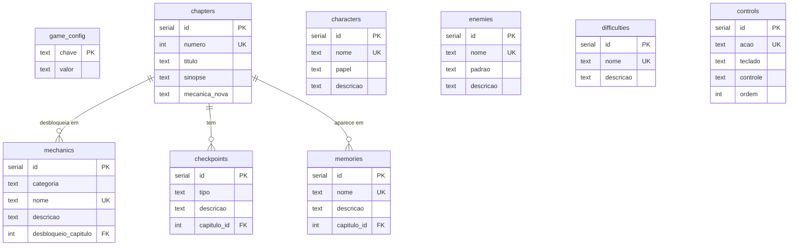

# 📋 Plano do Banco de Dados — Sandman

Documento que explica **como os dados do jogo foram separados e organizados**
no PostgreSQL. Complementa o `PLANO-DO-JOGO.md`.

## 1. Por que um banco de dados?

O plano do jogo prevê:

- 5 capítulos com mecânicas que evoluem;
- personagens, inimigos e controles;
- dificuldades e checkpoints;
- itens narrativos (memórias/flashbacks).

Se tudo isso ficar espalhado em arquivos e código, cada ajuste de balanceamento
vira uma caça ao tesouro. Com o banco centralizado, o jogo consulta a API e o
conteúdo pode evoluir sem recompilar o jogo.

## 2. Modelo de dados (diagrama)



## 3. Organização das tabelas

| Grupo | Tabelas | Por quê |
|---|---|---|
| **Configuração** | `game_config` | Valores globais em chave/valor: nome, gênero, duração, resolução, regras de morte. Fácil de ajustar sem migração. |
| **Conteúdo narrativo** | `chapters`, `characters`, `memories` | O que conta a história. |
| **Sistemas de jogo** | `mechanics`, `enemies`, `difficulties`, `controls` | O que o jogador sente e aperta. |
| **Progressão** | `checkpoints` | Onde o jogador reinicia. |

## 4. Decisões de design

1. **Português nos nomes de colunas** — o projeto é em português; manter os
   nomes no idioma do jogo evita traduções mentais.
2. **`categoria` como texto com `CHECK`** em `mechanics` — simples de ler no
   banco e de filtrar na API (`?categoria=combate`), sem tabela extra.
3. **`desbloqueio_capitulo` referenciando `chapters(numero)`** — o capítulo é
   identificado pelo número (1–5), que é estável; o `id` técnico fica para as
   chaves estrangeiras de outras tabelas.
4. **`memories` criada vazia de propósito** — o roteiro dos flashbacks ainda
   não existe no design doc. A tabela já está pronta para receber.
5. **Sem tabela de save do jogador** — por decisão do plano, o save é local
   (`localStorage`). Se um dia houver save na nuvem, entram `players` e
   `saves` sem quebrar nada do que já existe.
6. **API somente leitura** (exceto a inicialização protegida) — o conteúdo do
   jogo não deve ser alterável por qualquer jogador.

## 5. Roadmap do banco

- [x] Schema com as 9 tabelas
- [x] Seed com todo o conteúdo do `PLANO-DO-JOGO.md`
- [x] API REST pública
- [ ] Popular `memories` quando o roteiro dos flashbacks for escrito
- [ ] Adicionar posições de fogueiras quando o design de fases existir
- [ ] (Opcional) Contas + save na nuvem

## 6. Como o jogo usa os dados

```js
// Exemplo no jogo (fetch da API hospedada no Render)
const resposta = await fetch('https://sandman-api.onrender.com/api/chapters');
const capitulos = await resposta.json();
```

A URL final aparece no dashboard do Render após o deploy.
